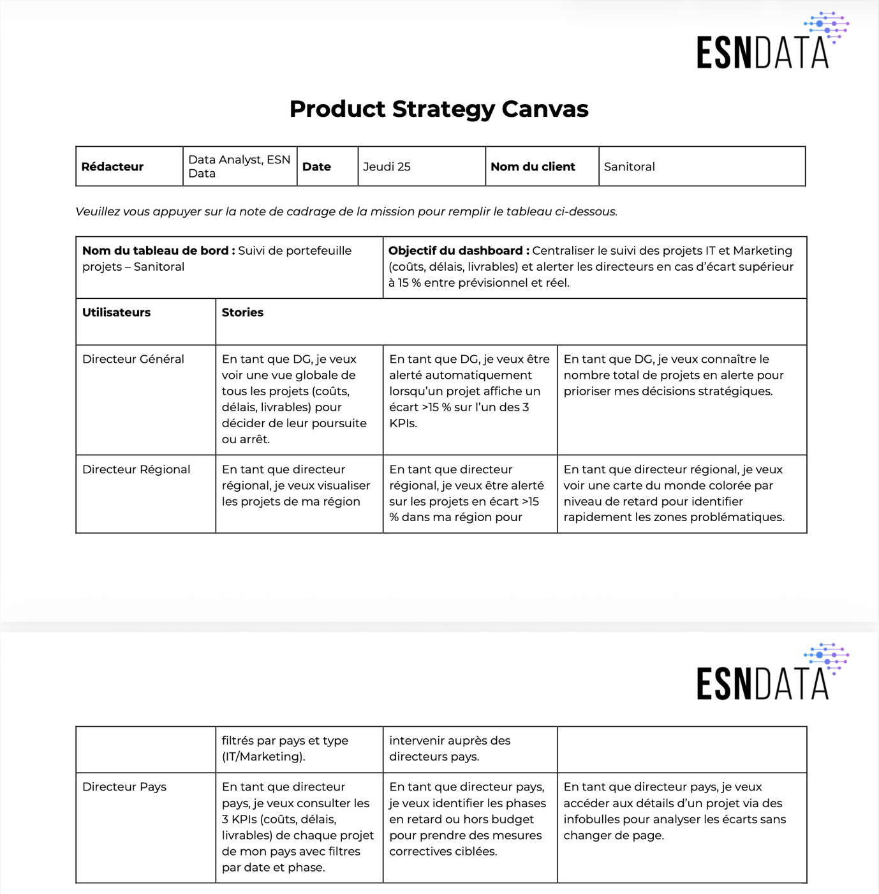

# Sanitoral — tableau de bord Power BI de suivi de portefeuille projets

> Un tableau de bord à trois niveaux de lecture (directeur général, régional, pays) alerte dès qu'un projet dérive de plus de 15 %. Il a fait ressortir une cause structurelle de dépassement : la phase de test des projets IT, sous-budgétée de +472 % en moyenne.



**Projet 7 · OpenClassrooms Data Analyst · juillet 2026** · Power BI · Power Query · DAX · Modélisation en étoile · Product Strategy Canvas

---

## Besoin métier
Sanitoral, groupe de santé présent dans 4 grandes régions du monde, pilote 104 projets IT et Marketing (2018–2022) avec 3 indicateurs : **coûts, délais et livrables**. Ses directeurs ont les données mais aucune vision consolidée. Le besoin :
- **le directeur général** suit tout le portefeuille et décide de la poursuite ou de l'arrêt des projets ;
- **le directeur régional** est alerté sur les projets de sa région ;
- **le directeur pays** pilote les actions correctives ;
- **règle d'alerte :** un écart de plus de 15 % entre le prévisionnel et le réel sur l'un des 3 indicateurs.

## Données
- **Source :** un classeur Excel de 7 onglets (plans, coûts, durées et livrables réels, localisation, type, profil pays).
- **Qualité, corrigée dans Power Query :**
  - lignes d'en-tête parasites ;
  - clé projet nommée de 4 façons différentes (`Project ID`, `Proj_ID`, `Project`, `ID`) ;
  - tris différents d'un onglet à l'autre ;
  - fautes dans les noms (`Delivrable`).

## Démarche
1. **Cadrage :** traduire la note de cadrage en **Product Strategy Canvas**, avec 3 profils d'utilisateurs et 9 user stories.
2. **Préparation (Power Query) :** nettoyer les données, harmoniser les clés, fusionner les 4 onglets de mesures dans une table de faits (1 ligne = 1 phase de projet).
3. **Modèle en étoile :** une table de faits `fact_Phases` et des dimensions Projets et Pays, en relations plusieurs-à-un.
4. **DAX :**
   - écarts en % pour chaque indicateur ;
   - indicateurs d'alerte à plus de 15 % ;
   - phase en alerte quand au moins un indicateur dépasse ;
   - nombre et taux de projets en alerte.
5. **Restitution en 4 pages :**
   - vue exécutive ;
   - vue régionale, avec une carte du monde colorée selon le retard ;
   - vue projet / pays, avec info-bulles de détail ;
   - documentation intégrée au rapport.

## Résultats
- Un rapport qui répond aux 9 user stories, avec des filtres par type de projet, région, pays et période de phase.
- **Axe stratégique :**
  - la phase **D – Testing** des projets IT dépasse son budget de **+472 %** en moyenne (de +175 % à +974 % sur les 52 projets IT), ce qui exclut un cas isolé ;
  - la phase E – Deployment est sous-consommée (−32 %), peut-être en raison d'une réduction de périmètre.

## Recommandations
- Appliquer un coefficient correctif d'au moins ×3 aux budgets de la phase de test.
- Instaurer une revue obligatoire (« gate review ») à l'entrée de la phase D.
- Créer une réserve pour aléas de test représentant 20 % du budget IT.

## Limites et pistes
- Toutes les phases sont considérées d'importance égale, conformément à la demande du client. Une pondération par budget serait plus fidèle.
- Les données s'arrêtent en 2022 : il faudra un rafraîchissement planifié via Power BI Service.
- Les rôles RLS par région et par pays restent à mettre en place pour une diffusion réelle.

## Compétences mobilisées
`Power BI` · `Power Query` · `DAX` · `Modèle en étoile` · `Product Strategy Canvas` · `User stories` · `Data storytelling`

## Contenu
```
livrables/
  Cabart_Leo_1_tableau_de_bord_072026.pbix   # rapport Power BI
  product_strategy_canvas.pdf
  guide_construction_powerbi.pdf             # modèle, mesures DAX, plan du rapport, axe stratégique
data/
  donnees_sanitoral.xlsx                     # jeu de données fictif fourni pour l'exercice
  dictionnaire_donnees.xlsx
```
Pour ouvrir le rapport : Power BI Desktop (gratuit, Windows).

---
Leo Cabart · Data Analyst · [Portfolio](https://lcabart21.github.io) · [GitHub](https://github.com/lcabart21)
